# Conversation and MCP Workflow

The diagram covers the CLI and Streamlit conversation flow, the Streamlit
resume-management actions, and both Streamable HTTP MCP servers. The
filesystem server supplies resume data; the optional SQLite interview server
supplies skill-indexed screening questions when enabled in Streamlit.

```mermaid
flowchart TD
    User([User]) --> Interface{Interface}
    Interface -->|Terminal| CLI[CLI input and output]
    Interface -->|Browser| UI[Streamlit chat and session state]
    CLI --> Message[Submit message]
    UI --> Message

    Message --> Intent{Classify intent}
    Intent -->|New search| NewSearch
    Intent -->|New search after shortlist| NewSearch
    Intent -->|Refine criteria| Refine
    Intent -->|Compare| Compare
    Intent -->|Explain ranking| Explain
    Intent -->|Deep analysis / second round| DeepAnalysis
    Intent -->|Final hire / no-hire| FinalDecision
    Intent -->|Screening questions| ScreeningQuestions
    Intent -->|Exit / quit in CLI| Exit([End CLI session])
    subgraph OfflineIndexing["Offline ChromaDB indexing · resume_rag.py"]
        LoadIndexDocs[Load supported resume files] --> ChunkDocs[Chunk resume text]
        ChunkDocs --> EmbedDocs[Create embeddings and metadata]
        EmbedDocs --> PersistIndex[Persist ChromaDB index]
    end
    PersistIndex -. populated index enables .-> VectorSearch

    subgraph InitialScreen["Initial or refreshed LangGraph screening"]
        NewSearch[Parse job request] --> Extract[Extract required and preferred skills and experience]
        Refine --> SavePreviousRankings[Retain current shortlist for ranking-change report]
        SavePreviousRankings --> UpdateCriteria[Append feedback and update active requirements]
        UpdateCriteria --> Extract
        Extract --> Search[Search resume collection]
        Search --> MCPBatchCall[Initialize filesystem MCP; discover resources and templates; call batch_process]
        MCPBatchCall --> SearchMode{Search mode}
        SearchMode -->|Recognized skill| ExactSkill[Exact-boundary skill matching]
        SearchMode -->|Other query; populated index| VectorSearch[ChromaDB semantic search]
        SearchMode -->|Other query; empty index| LexicalSearch[Local lexical fallback]
        ExactSkill --> Rank[Rank and deduplicate candidates]
        VectorSearch --> Rank
        LexicalSearch --> Rank
        Rank --> SearchReport[Generate evidence-based initial report]
    end

    SearchReport --> SaveState[Save current job, candidates, shortlist, and report]
    SearchReport -. on refinement .-> RankingChanges[Compare with retained shortlist and explain ranking changes]
    RankingChanges --> SaveState

    Compare --> CompareReport[Compare shortlisted candidates]
    Explain --> ExplainReport[Explain candidate ranking]
    DeepAnalysis --> DeepReport[Generate evidence-based second-round analysis]
    FinalDecision --> DecisionReport[Apply heuristic hire / no-hire gates]
    CompareReport --> SaveState
    ExplainReport --> SaveState
    DeepReport --> SaveState
    DecisionReport --> SaveState

    ScreeningQuestions --> BaseQuestions[Generate role-focused questions]
    BaseQuestions --> UseInterviewMCP{Interview MCP enabled in Streamlit?}
    UseInterviewMCP -->|No; CLI or unchecked| SaveState
    UseInterviewMCP -->|Yes| DiscoverInterview[Initialize interview MCP session and discover resources]
    DiscoverInterview --> InterviewResources
    InterviewResources --> ReadQuestionResources[Read skills catalog and question bank]
    ReadQuestionResources --> AddBankQuestions[Append matching skill and general questions]
    AddBankQuestions --> SaveState
    ReadQuestionResources -. MCP/protocol errors surfaced .-> MCPError[Show request error in Streamlit]

    SaveState --> Display[Display report and await next message]
    Display --> Message
    UI -->|Start a new conversation| Reset[Clear browser-session chat and agent state]
    Reset --> UI

    subgraph StreamlitActions["Streamlit sidebar resume actions"]
        UI --> CountResumes[Show supported resume count]
        CountResumes --> MCPListCall[Call list_files]
        UI --> BatchButton[Batch process resumes button]
        BatchButton --> MCPBatchUI[Initialize filesystem MCP; discover; call batch_process]
        UI --> WatchButton[Watch for new resumes button]
        WatchButton --> MCPWatchCall[Initialize filesystem MCP; discover; call watch_directory]
    end

    subgraph FilesystemMCP["Filesystem MCP server · Streamable HTTP / JSON-RPC 2.0"]
        FSResources["Resources: filesystem://config<br/>filesystem://resumes<br/>Template: filesystem://resumes/{filename}"]
        FSTools["Tools: get_server_config, list_files, read_file,<br/>write_file, search_in_file, batch_process, watch_directory"]
        FSBatch["tools/call: batch_process"]
        FSList["tools/call: list_files"]
        FSWatch["tools/call: watch_directory"]
    end
    MCPBatchCall --> FSBatch
    FSBatch --> SearchMode
    MCPBatchUI --> FSBatch
    FSBatch --> BatchResult[Show processed filenames and per-file errors]
    MCPListCall --> FSList
    FSList --> ResumeCount[Display current supported-file count]
    MCPWatchCall --> FSWatch
    FSWatch --> WatchResult[Show new files or timeout]
    FSResources -. advertised during discovery .-> MCPBatchCall
    FSTools -. advertised during discovery .-> MCPBatchCall
    MCPListCall -. initialize and discover .-> FSResources
    MCPListCall -. initialize and discover .-> FSTools
    MCPBatchUI -. initialize and discover .-> FSResources
    MCPBatchUI -. initialize and discover .-> FSTools
    MCPWatchCall -. initialize and discover .-> FSResources
    MCPWatchCall -. initialize and discover .-> FSTools
    FSBatch -. MCP/protocol errors surfaced .-> MCPError
    FSList -. MCP/protocol errors surfaced .-> MCPError
    FSWatch -. MCP/protocol errors surfaced .-> MCPError

    subgraph InterviewMCP["Optional interview MCP server · Streamable HTTP / JSON-RPC 2.0"]
        InterviewResources["SQLite resources: interview-db://skills<br/>interview-db://question-bank"]
    end
```

## Runtime and behavior notes

- Both interfaces keep the current conversation in memory. The CLI uses
  process-local state; Streamlit uses browser-session state. Starting a new
  Streamlit conversation clears that state.
- The filesystem MCP server defaults to `http://127.0.0.1:8000/mcp`. Its
  resources describe configuration and resume files. Its tools list, read,
  write, and search files, process supported files concurrently, and watch
  for supported files added after the server starts. File access is confined
  to the configured resume directory.
- Resume search reads current files through `batch_process`. Recognized skill
  queries use exact-boundary matching; other queries use ChromaDB when the
  persisted index contains data, or local lexical search when it is empty.
- `resume_rag.py` is the separate offline indexing workflow: it loads supported
  files, chunks and embeds them, and persists the ChromaDB index used for
  semantic retrieval.
- Streamlit's sidebar can separately batch-process resumes or watch for new
  ones. Watching reports new file contents; it does not automatically trigger
  a chat search or rebuild the ChromaDB index.
- The optional interview MCP server defaults to
  `http://127.0.0.1:8001/mcp` and serves SQLite-backed skill and question-bank
  resources. Start it separately and enable **Use SQLite interview question
  bank** in Streamlit to include those questions in screening-question
  responses. The CLI does not currently enable this integration.
- MCP clients initialize a session before discovery and calls. The
  filesystem client discovers resources and templates before tool calls; the
  interview client discovers and reads its two resources for each enabled
  screening-question request. MCP failures are reported rather than silently
  replaced with successful-looking results.
